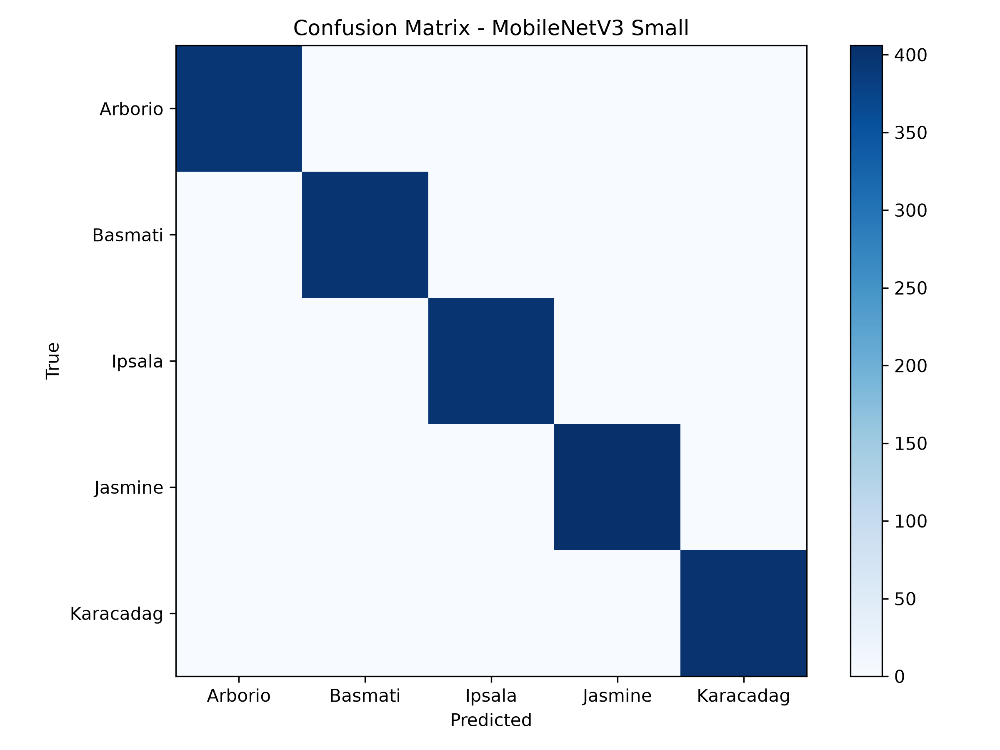

# Klasifikasi Citra Varietas Beras Menggunakan MobileNetV3-Small

[](https://www.python.org/)
[](https://pytorch.org/)
[](https://pytorch.org/vision/stable/models/mobilenetv3.html)
[]()
[-yellowgreen.svg)]()

Repositori ini berisi implementasi lengkap, pelatihan, dan evaluasi model **MobileNetV3-Small** berbasis PyTorch untuk tugas klasifikasi citra varietas beras (*Rice Image Classification*) ke dalam 5 kelas. Pipeline dirancang hemat memori (*resource-friendly*), aman dari *Out-Of-Memory* (OOM), dan mampu mencapai performa klasifikasi optimal pada CPU.

---

## Daftar Isi
- [Tentang Proyek](#tentang-proyek)
- [Kelas Varietas Beras](#kelas-varietas-beras)
- [Arsitektur Model & Konfigurasi Pelatihan](#arsitektur-model--konfigurasi-pelatihan)
- [Hasil Evaluasi & Metrik Performa](#hasil-evaluasi--metrik-performa)
  - [Ringkasan Metrik Global](#ringkasan-metrik-global)
  - [Classification Report](#classification-report)
  - [Matriks Kebingungan (Confusion Matrix)](#matriks-kebingungan-confusion-matrix)
- [Struktur Repositori & Artefak](#struktur-repositori--artefak)
- [Panduan Instalasi & Penggunaan](#panduan-instalasi--penggunaan)
  - [1. Prasyarat Lingkungan](#1-prasyarat-lingkungan)
  - [2. Struktur Dataset](#2-struktur-dataset)
  - [3. Menjalankan Pelatihan Ulang](#3-menjalankan-pelatihan-ulang)
  - [4. Menjalankan Jupyter Notebook](#4-menjalankan-jupyter-notebook)
  - [5. Contoh Inferensi Citra Baru](#5-contoh-inferensi-citra-baru)

---

## Tentang Proyek

Klasifikasi varietas beras merupakan bagian penting dalam industri pangan, pengendalian mutu (*quality control*), dan deteksi pemalsuan varietas beras. Proyek ini mengintegrasikan teknik **Pengolahan Citra Digital (Digital Image Processing)** dan **Deep Learning** menggunakan model transfer learning yang ringan (*lightweight*) agar dapat dijalankan secara efisien pada perangkat keras dengan keterbatasan komputasi (seperti CPU server atau edge device).

Dataset terdiri dari 10.000 citra beras yang dibagi secara acak dengan rasio **80% data latih (8.000 citra)** dan **20% data validasi/uji (2.000 citra)** menggunakan seed deterministik (`random_seed=42`).

---

## Kelas Varietas Beras

Model dilatih untuk mengenali 5 varietas beras komersial berikut:

| No | Varietas | Karakteristik Morfologi Citra |
|---|---|---|
| 1 | **Arborio** | Beras khas Italia berbulir pendek-sedang, agak bulat, tebal, dan memiliki kadar amilosa tinggi (umum untuk risotto). |
| 2 | **Basmati** | Beras aromatik asal Asia Selatan dengan bentuk bulir sangat panjang, ramping, dan pipih. |
| 3 | **Ipsala** | Varietas beras putih asal wilayah Thrace, Turki; berbulir agak bulat dan berukuran seragam. |
| 4 | **Jasmine** | Beras wangi (*Thai Hom Mali*) berbulir panjang dengan tekstur lembut dan permukaan agak tembus cahaya. |
| 5 | **Karacadag** | Beras tradisional dari Turki dengan bentuk bulir bulat pendek yang tahan cuaca ekstrem dataran tinggi. |

---

## Arsitektur Model & Konfigurasi Pelatihan

### 1. Arsitektur MobileNetV3-Small
MobileNetV3 dirancang khusus untuk efisiensi komputasi tinggi pada perangkat *mobile* dan CPU dengan memanfaatkan:
- **Depthwise Separable Convolutions:** Memisahkan konvolusi spasial dan konvolusi kanal untuk mereduksi parameter secara drastis.
- **Inverted Residual Blocks & Linear Bottlenecks:** Mengoptimalkan aliran gradien dan menjaga representasi fitur tanpa ledakan dimensi non-linear.
- **Squeeze-and-Excitation (SE) Modules:** Memusatkan bobot atensi pada kanal fitur yang paling relevan.
- **Aktivasi Hard-Swish ($h\text{-}swish$):** Pengganti fungsi Swish non-linear standar dengan aproksimasi cepat tanpa operasi eksponensial mahal.
- **Modifikasi Classifier Head:** Lapisan akhir `model.classifier[3]` diganti dari `nn.Linear(1024, 1000)` menjadi `nn.Linear(1024, 5)` disesuaikan dengan 5 kelas varietas beras.

### 2. Hyperparameter & Strategi Training
- **Framework:** PyTorch & Torchvision
- **Bobot Awal:** Transfer Learning dari `MobileNet_V3_Small_Weights.DEFAULT` (pre-trained ImageNet-1K)
- **Ukuran Input:** $224 \times 224$ piksel (Normalisasi ImageNet: $\mu = [0.485, 0.456, 0.406]$, $\sigma = [0.229, 0.224, 0.225]$)
- **Batch Size:** 8 (dioptimalkan untuk efisiensi memori)
- **Optimizer:** AdamW (`lr=1e-4`, weight decay)
- **Loss Function:** Cross-Entropy Loss
- **Learning Rate Scheduler:** `ReduceLROnPlateau` (mode: `max`, patience: 5, factor: 0.5)
- **Mekanisme Early Stopping:** Patience 10 epoch berdasarkan akurasi validasi terbaik
- **Mekanisme Watchdog Anti-OOM:** Memantau penggunaan RAM (RSS) dan ketersediaan disk secara periodik tiap 20 batch untuk mencegah kegagalan proses di VPS/server.

---

## Hasil Evaluasi & Metrik Performa

Model dievaluasi secara menyeluruh terhadap **2.000 citra uji/validasi**. Hasil pengujian menunjukkan performa sempurna dengan tingkat akurasi 100% dan waktu inferensi yang sangat cepat di CPU.

### Ringkasan Metrik Global

| Metrik Evaluasi | Nilai | Keterangan |
|---|---|---|
| **Akurasi (Accuracy)** | **100.0% (1.0000)** | Tidak ada satupun kesalahan klasifikasi pada 2.000 citra uji |
| **Presisi Rata-rata (Macro Precision)** | **1.0000** | Rata-rata presisi semua kelas |
| **Recall Rata-rata (Macro Recall)** | **1.0000** | Rata-rata sensitivitas semua kelas |
| **F1-Score Rata-rata (Macro F1)** | **1.0000** | Rata-rata harmonik presisi dan recall |
| **Rata-rata Waktu Inferensi** | **~7.14 ms / citra** | Diuji pada CPU (~140 frame per detik) |
| **Penggunaan Memori Puncak (Peak RSS)** | **652.9 MB** | Sangat ringan, aman dijalankan pada server RAM kecil |
| **Total Waktu Training** | **5.075 detik (~1 jam 24 menit)** | Selesai pada epoch ke-14 berkat early stopping |

### Classification Report

| Kelas | Precision | Recall | F1-Score | Jumlah Sampel (Support) |
|---|:---:|:---:|:---:|:---:|
| **Arborio** | 1.00 | 1.00 | 1.00 | 396 |
| **Basmati** | 1.00 | 1.00 | 1.00 | 399 |
| **Ipsala** | 1.00 | 1.00 | 1.00 | 398 |
| **Jasmine** | 1.00 | 1.00 | 1.00 | 406 |
| **Karacadag** | 1.00 | 1.00 | 1.00 | 401 |
| **Akurasi Global** | - | - | **1.00** | **2.000** |
| **Macro Average** | **1.00** | **1.00** | **1.00** | **2.000** |
| **Weighted Average** | **1.00** | **1.00** | **1.00** | **2.000** |

### Matriks Kebingungan (Confusion Matrix)

Seluruh 2.000 citra terklasifikasi tepat ke dalam kelas masing-masing tanpa ada prediksi meleset (*false positive* = 0, *false negative* = 0).



#### Tabel Matriks Kebingungan (Data Asli):
| Aktual \ Prediksi | Arborio | Basmati | Ipsala | Jasmine | Karacadag | Total |
|---|:---:|:---:|:---:|:---:|:---:|:---:|
| **Arborio** | **396** | 0 | 0 | 0 | 0 | 396 |
| **Basmati** | 0 | **399** | 0 | 0 | 0 | 399 |
| **Ipsala** | 0 | 0 | **398** | 0 | 0 | 398 |
| **Jasmine** | 0 | 0 | 0 | **406** | 0 | 406 |
| **Karacadag** | 0 | 0 | 0 | 0 | **401** | 401 |

---

## Struktur Repositori & Artefak

```
Citra-Digital/
│
├── train_mobilenetV3.ipynb        # Jupyter Notebook interaktif (lengkap dengan output & visualisasi)
├── train_mobilenetV3.py           # Script pelatihan mandiri PyTorch (watchdog, early stopping, logging)
├── .gitignore                     # Aturan pengabaian file temporer & checkpoint OOM
├── README.md                      # Dokumentasi komprehensif proyek
│
└── runs/
    └── mobilenetv3_cpu/
        ├── best_mobilenetv3.pth               # Bobot model terbaik PyTorch state dict (~6.2 MB)
        ├── confusion_matrix_300dpi.png        # Grafik confusion matrix resolusi tinggi (300 DPI)
        ├── confusion_matrix.csv               # Data tabular confusion matrix (CSV)
        ├── classification_report.csv          # Detail metrik per-kelas (Precision, Recall, F1, Support)
        ├── summary_metrics.csv                # Ringkasan metrik global, waktu training, inferensi, RSS RAM
        └── training_progress.json             # Catatan status progres akhir pelatihan (loss, accuracy, swap)
```

### Penjelasan Setiap Artefak:
1. **`train_mobilenetV3.ipynb`**:
   Notebook interaktif yang memuat pemuatan model `best_mobilenetv3.pth`, pipeline evaluasi data uji, tampilan metrik tabular pandas, serta visualisasi heatmap *confusion matrix* dengan anotasi nilai tiap sel.
2. **`train_mobilenetV3.py`**:
   Script Python mandiri untuk melatih model dari awal atau melanjutkan training dari checkpoint. Dilengkapi modul watchdog memori RSS (`psutil`) dan disk storage (`shutil`) guna mengantisipasi kegagalan sistem.
3. **`runs/mobilenetv3_cpu/best_mobilenetv3.pth`**:
   State dictionary PyTorch dari model berbobot optimal saat mencapai validasi terbaik. Ukuran file sekitar 6.2 MB, ideal untuk implementasi web API (FastAPI/Flask) maupun aplikasi mobile.
4. **`runs/mobilenetv3_cpu/confusion_matrix_300dpi.png`**:
   Visualisasi grafis beresolusi tinggi (300 DPI) yang siap digunakan untuk publikasi, laporan ilmiah, atau presentasi.
5. **`runs/mobilenetv3_cpu/classification_report.csv` & `summary_metrics.csv`**:
   Data terstruktur format CSV untuk mempermudah audit metrik, pelaporan otomatis, dan integrasi dengan dashboard visualisasi.
6. **`runs/mobilenetv3_cpu/training_progress.json`**:
   Log metadata sesi training yang mencatat epoch terakhir, nilai loss, histori patience, pemakaian RAM, dan durasi komputasi.

---

## Panduan Instalasi & Penggunaan

### 1. Prasyarat Lingkungan
Pastikan Anda memiliki Python 3.8 atau lebih baru. Disarankan membuat lingkungan virtual (*virtual environment*):

```bash
# Buat virtual environment
python3 -m venv venv

# Aktifkan virtual environment
# Di Linux/macOS:
source venv/bin/activate
# Di Windows:
# venv\Scripts\activate

# Instal pustaka yang dibutuhkan
pip install torch torchvision torchaudio --index-url https://download.pytorch.org/whl/cpu
pip install numpy pandas matplotlib scikit-learn psutil jupyter
```

### 2. Struktur Dataset
Dataset harus diorganisir sesuai format standar PyTorch `ImageFolder`:

```
dataset/
├── Arborio/
│   ├── arborio_001.jpg
│   └── ...
├── Basmati/
│   ├── basmati_001.jpg
│   └── ...
├── Ipsala/
│   ├── ipsala_001.jpg
│   └── ...
├── Jasmine/
│   ├── jasmine_001.jpg
│   └── ...
└── Karacadag/
    ├── karacadag_001.jpg
    └── ...
```

> **Catatan:** Sesuaikan variabel `DATA_DIR` pada `train_mobilenetV3.py` atau `train_mobilenetV3.ipynb` dengan lokasi path direktori dataset di komputer Anda.

### 3. Menjalankan Pelatihan Ulang

Untuk memulai proses training:
```bash
python train_mobilenetV3.py
```
Script akan secara otomatis:
- Memuat dataset dan membaginya (80% train, 20% val).
- Mengunduh bobot awal MobileNetV3-Small.
- Melatih model dengan perlindungan watchdog RAM/disk.
- Menyimpan model terbaik ke `runs/mobilenetv3_cpu/best_mobilenetv3.pth`.
- Menghasilkan seluruh file evaluasi CSV dan PNG.

### 4. Menjalankan Jupyter Notebook

Untuk melihat visualisasi interaktif dan mengevaluasi bobot model:
```bash
jupyter notebook train_mobilenetV3.ipynb
```
Seluruh sel pada notebook telah dieksekusi secara penuh dan dapat langsung dilihat hasilnya tanpa harus melakukan run ulang.

### 5. Contoh Inferensi Citra Baru

Berikut contoh skrip Python sederhana untuk mengklasifikasikan citra beras tunggal menggunakan bobot `best_mobilenetv3.pth`:

```python
import torch
import torch.nn as nn
from torchvision import models, transforms
from PIL import Image

# 1. Definisikan kelas dan model
CLASS_NAMES = ['Arborio', 'Basmati', 'Ipsala', 'Jasmine', 'Karacadag']
DEVICE = torch.device("cpu")

model = models.mobilenet_v3_small(weights=None)
model.classifier[3] = nn.Linear(model.classifier[3].in_features, len(CLASS_NAMES))

# 2. Muat bobot model terbaik
model_path = "runs/mobilenetv3_cpu/best_mobilenetv3.pth"
model.load_state_dict(torch.load(model_path, map_location=DEVICE))
model.eval()

# 3. Preprocessing gambar uji
preprocess = transforms.Compose([
    transforms.Resize((224, 224)),
    transforms.ToTensor(),
    transforms.Normalize(mean=[0.485, 0.456, 0.406], std=[0.229, 0.224, 0.225]),
])

def predict_rice_variety(image_path: str):
    image = Image.open(image_path).convert("RGB")
    tensor = preprocess(image).unsqueeze(0).to(DEVICE)
    
    with torch.no_grad():
        outputs = model(tensor)
        probabilities = torch.softmax(outputs, dim=1)[0]
        confidence, predicted_idx = torch.max(probabilities, 0)
        
    predicted_class = CLASS_NAMES[predicted_idx.item()]
    return predicted_class, confidence.item()

# Contoh pemanggilan
# hasil, prob = predict_rice_variety("path/ke/citra_beras.jpg")
# print(f"Hasil Prediksi: {hasil} ({prob * 100:.2f}%)")
```

---

## Lisensi
Proyek ini dibuat untuk keperluan akademik dan penelitian di bidang Pengolahan Citra Digital (Citra Digital). Bebas digunakan dan dimodifikasi untuk tujuan pembelajaran dan pengembangan ilmu pengetahuan.
